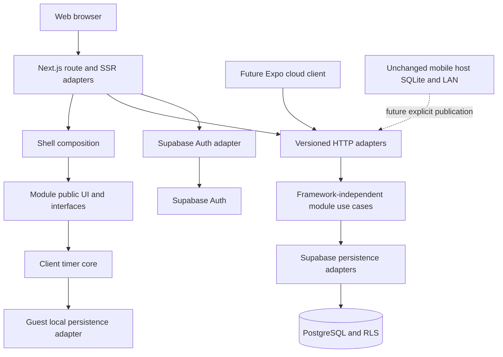
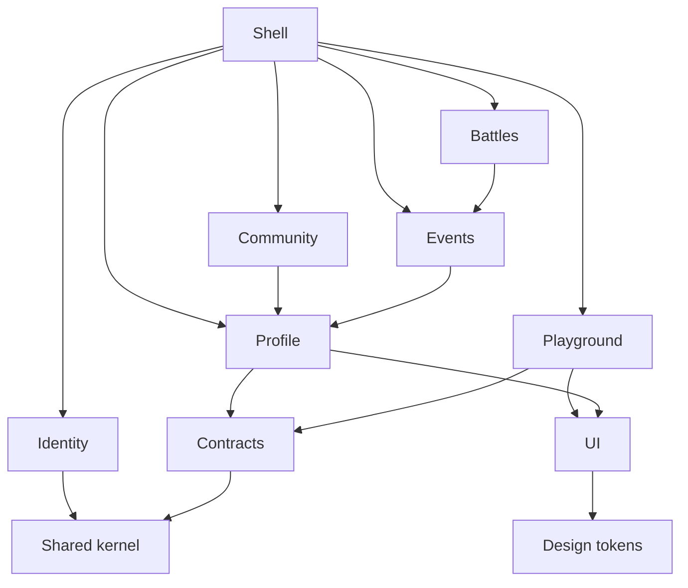

# Platform Architecture

Confirmed architecture is ADR-001 through ADR-014, recorded in [04-architecture-decision-records.md](04-architecture-decision-records.md). Everything described here is a proposed future implementation, not an existing mobile module.

## Repository and deployment

Create a separate pnpm workspaces + Turborepo monorepo in Phase 1:

```text
apps/web
packages/ui
packages/design-tokens
packages/contracts
packages/shared-kernel
packages/config
supabase/migrations
docs/architecture
docs/adr
tests/e2e
```

Inside apps/web, use framework route adapters under src/app, platform composition under src/shell, and modules/{identity,profile,playground}. Future contexts receive directories only when implemented. Practice Timer belongs under modules/playground/apps/practice-timer, not an initial separate workspace. Packages should expose named public exports, not wildcard paths. Shared-kernel contains genuinely shared primitives such as UserId and typed errors, not battle code or a generic service framework. Config contains compile/lint configuration only, never runtime credentials.



Public profile pages can be SSR. Playground catalog metadata can be server-rendered; timer interactivity is a client boundary. Initial routes /en, /ru, /{locale}/playground, /{locale}/playground/practice-timer, /{locale}/login, /{locale}/register, /{locale}/account and /{locale}/profiles/{userId}. APIs remain locale-neutral /api/v1. Root / redirects to /en deterministically; explicit locale navigation preserves the logical route. Namespaced resources: shell, identity, profile, playground, practiceTimer. Evaluate next-intl in Phase 1 using [its routing documentation](https://next-intl.dev/docs/routing/setup); exact framework/library versions remain unselected.

## Bounded contexts

| Context | Responsibilities / owned data | Public interface | Allowed dependencies | Forbidden dependencies | Future extraction |
| --- | --- | --- | --- | --- | --- |
| Identity | Authentication adapters, verified principal, account lifecycle; provider owns credentials | resolvePrincipal, requirePrincipal, requestDeletion; UserId/Principal contracts | Shared-kernel, provider ports | Profile stores, timer state, battle participant IDs as principal | Move provider/use-case adapters behind versioned API without changing UserId |
| Profile | Public projection, owner editing, privacy, user preferences; profiles/privacy/preferences | readOwnProfile, readPublicProfile, listDiscoverableProfiles, updateProfile/updatePrivacy/updatePreferences, ensureProfile | Principal supplied as argument; shared UserId; persistence port | Identity internals/provider metadata for authorization; Playground stores | Extract profile API/storage after stable DTOs |
| Playground | Catalog, validated per-app persistence, micro-app registration; playground_user_data | listApps, getData, putData, deleteData; app registration API | Supplied principal, contracts, shared-kernel, UI/tokens | Profile/community/battle internals; other app private modules | Route-based extraction with stable app ID and preset API |
| Community, future | Posts, reactions, moderation; own relational data | publish/read/moderate contracts, future only | UserId; Profile public projection for display | Identity password/token APIs, battle logs, profile-table writes | Independent routes/API if moderation or release cadence warrants |
| Events, future | Cloud event discovery, membership and organizer permissions | event queries, membership authorization, future only | UserId, public Profile read contract | Local host store, timer internals, credential storage | Dedicated event API if workload warrants |
| Battles, future | Explicit cloud publication/import boundary and participant links; not live host authority | publishBattle, claimParticipantLink, readPublication, future only | Events public authorization interface, UserId/contracts | Direct mobile SQLite access or changing local host authority | Publication API isolated from native LAN execution |

Identity does not invoke Profile directly. A shell/application composition use case coordinates verified principal + ensureProfile. Account deletion coordinates each module's cleanup through public deletion interfaces and database cascades, rather than mutually importing features.



Edges indicate allowed runtime import direction. Future principal checks use a passed Principal value or a composition adapter, avoiding reverse imports into Identity. Contracts depend only on shared-kernel and selected schema tooling; do not import implementation modules. No circular runtime edge is permitted.

## Enforceable import rules

Future lint rules should block modules/*/** imports from other modules unless through their explicit index/public entrypoint; block cross-app imports within Playground; block private stores everywhere outside their owning module; block framework, DOM, React, Supabase SDK and persistence imports in core/use-case files; block server modules in client graphs; block Next.js imports in packages/contracts and shared-kernel; and block apps imports from packages. Boundary enforcement can use ESLint restricted-import patterns plus an architecture dependency check. Dynamic imports must follow the same graph.

Micro-apps receive narrow shell services (locale, optional principal summary, persistence port), never provider tokens or unrelated stores. Shell owns global auth context and navigation; modules own their feature behavior. A micro-app manifest is routing metadata, not an authorization grant.

## Thin transport and future backend extraction

Route handler: parse request, resolve verified principal, validate DTO, call a focused use case, map result/error. Use case: enforce business ownership, concurrency and app schema rules. Adapter: call PostgreSQL functions or user-scoped Supabase queries. Trivial owner reads may be small functions with an injected adapter; no generic repository/service tower required. HTTP/native clients share language-neutral OpenAPI contracts. Extracting NestJS later replaces route adapters and deployment composition, not domain identities or timer logic.

Future Expo cloud login and preset/profile APIs are optional capabilities. Cloud unavailability must never stop local battle creation, scoring, SQLite replay or LAN Host operation. No auth/cloud module is added to this mobile checkout in Phase 0.
