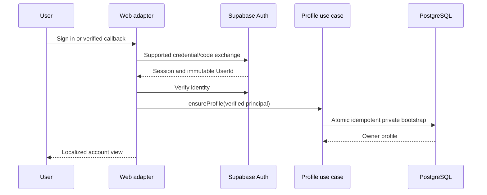

# Identity and Authentication

Confirmed: email/password, Google OAuth, immutable UUID UserId, privacy-controlled profiles and future Expo compatibility. Verified mobile `src/stores/session/useSessionStore.ts` handles only local roles; `src/infrastructure/storage/clientIdentityRepository.ts` handles device IDs. Neither is cloud authentication. All flows below are proposals.

## Account and session model

Supabase owns credentials, identities, verification and session/token issuance. auth.users.id is UserId; profiles.user_id is a one-to-one reference. Never infer authorization from username, email, browser state, user_metadata or local deviceId. Provider and profile concerns remain separate.

Use @supabase/ssr-compatible cookie sessions for web. Create request-scoped server clients and a browser client; refresh sessions through the framework's version-appropriate middleware/proxy. Verify signed claims for every protected request; never trust a cookie-loaded session object alone. Sensitive deletion additionally requires a fresh provider-backed user check and reauthentication. Authenticated responses and responses setting auth cookies use private/no-store caching; never cache account data in shared SSR/CDN responses. This follows [Supabase SSR guidance](https://supabase.com/docs/guides/auth/server-side/nextjs). Pin compatible versions in Phase 1; Next.js middleware/proxy conventions are version-sensitive.

Cookie options should use Secure in production and deliberate SameSite/domain/path settings. Do not assume the standard browser SDK model permits every auth cookie to be HttpOnly: token refresh may require browser access. Apply CSP, minimal third-party scripts, safe rendering and dependency review. For cookie-authenticated state changes check same-origin Origin and CSRF protection; bearer-token mobile calls do not rely on browser cookies. CORS is a transport policy, not authorization.

## Lifecycle flows

| Flow | Proposed steps and failure handling |
| --- | --- |
| Email registration | Validate email/password at client and server, submit to provider, use generic response against enumeration; require email verification; redirect to localized confirmation; no privileged account creation from browser |
| Verification | Allowlisted callback origin, provider-supported verification token/code exchange, reject invalid/expired/reused tokens, preserve safe locale; verified principal triggers idempotent profile bootstrap |
| Google OAuth | Provider redirect with PKCE/state managed by supported SDK; exact callback allowlist; server exchanges code; reject unsafe returnTo; bootstrap same UserId's profile |
| Sign-in | Provider credentials, rate limits and generic invalid-login response; resolve principal then owner data; optional import prompt for guest presets |
| Sign-out | Provider revokes requested session scope; clear account caches, drafts and pending cloud writes; keep intentionally stored guest presets; show guest tool without stale owner data |
| Recovery | Generic recovery response; email link to allowlisted callback, establish recovery session and change password via provider; expire recovery UI; do not expose whether email exists |
| Profile bootstrap | Idempotent ensureProfile in controlled DB transaction creates profile/privacy/preferences; absent privacy never means public; nullable username until owner sets it; defaults private/false/false; trigger optional only after failure testing |
| Account deletion | Fresh reauthentication, explicit confirmation, authenticated request; hide public profile/disable writes first, revoke sessions, delete owned storage, then provider admin deletion and cascades; durable retry record if provider/storage fails |

Locale callback state is en/ru from an allowlist; returnTo is a local relative path from an explicit route policy. Reject scheme URLs, protocol-relative URLs, control characters and arbitrary external destinations. OAuth/verification/recovery pages must not leak token/code parameters to analytics/referrers; use restrictive referrer policy and scrub after exchange. Email confirmation and password reset email links must be localized where provider templates permit. Delivery domain/SMTP configuration is unknown.

## Provider linking

[Supabase documents automatic and manual identity linking](https://supabase.com/docs/guides/auth/auth-identity-linking). Verify current behavior and provider configuration in staging; do not invent a custom email-based merge. Risks: unverified email takeover, duplicate accounts, provider email changes, linking to the wrong logged-in account, and losing the only login method when unlinking. Explicit linking requires a verified active account, fresh authentication, clear confirmation and audit event. Never merge two profiles or preset sets merely because emails match. Duplicate-account resolution is a separate reviewed support process; linking must preserve the canonical UUID and cloud ownership.

## Future Expo

Future Expo client may use provider-supported PKCE deep links and secure platform token storage with separate redirect allowlists. Access /api/v1 with a verified bearer access token for the same UUID. Do not copy web cookies into native storage or use the `koller` local scheme as proof of cloud identity. Confirm universal/app links and provider/native SDK compatibility in that later phase. Authentication is optional for cloud profile/preset/publication actions; local battle commands, LAN roles and SQLite persistence retain their existing authority and operate offline.

## Operational controls

Public browser code receives only the provider's publishable/anon key; secret/service-role keys belong in isolated server-only admin adapters and never normal data reads. Normal BFF queries carry the caller's identity and RLS. Configure Auth limits and optional provider-supported CAPTCHA; add shared edge/BFF rate limits for enumeration and write abuse. Use bounded request bodies, trusted client-IP extraction, per-account and per-IP budgets, and 429 Retry-After. Exact limits remain load-tested proposals. Log request ID/outcome/provider error category, never passwords, codes, tokens or complete private profile payloads.

Deletion and emergency account lock tests must include token revocation delay: a valid short-lived token alone may outlive sign-out. Server writes must also check a current deletion/disabled status in protected account data. Public read functions deny profiles marked deletion_requested_at. A durable deletion ledger should be in a restricted admin schema and is justified operational data, not a sixth public MVP product table.
