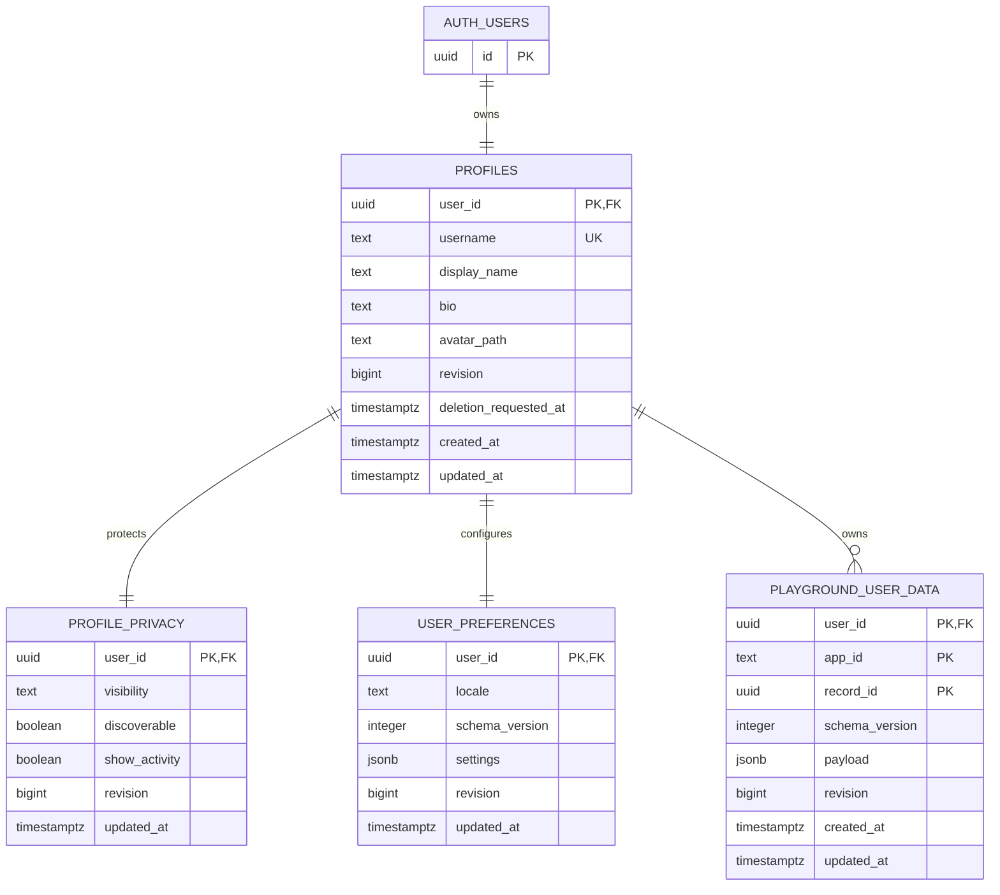

# Database and Privacy

Confirmed: Supabase PostgreSQL, UUID identity, private/non-discoverable defaults, owner cloud presets, validated bounded versioned JSONB. Proposed schema below is illustrative Markdown only. No migrations were created or executed. Mobile SQLite remains separate (`src/infrastructure/storage/migrations.ts`).

## MVP ERD



AUTH_USERS is the conceptual label for Supabase-managed auth.users, not a proposed table to create. Profiles contains only potentially public presentation fields plus internal lifecycle/revision fields. Public functions return a whitelisted projection, never SELECT *.

## Column and constraint specification

| Table | Columns and constraints | Ownership and indexes |
| --- | --- | --- |
| auth.users | Managed by Supabase; id UUID PK; credentials/email/provider identities stay managed | Never expose auth schema to public API |
| profiles | user_id UUID PK FK auth.users(id) ON DELETE CASCADE; username nullable TEXT UNIQUE normalized lowercase; display_name TEXT NOT NULL default ''; bio TEXT NOT NULL default ''; avatar_path nullable TEXT; revision BIGINT NOT NULL default 1 CHECK >0; deletion_requested_at nullable timestamptz; created_at/updated_at NOT NULL timestamptz | Owner-only base table; PK and username unique index; explicit public projection hides internal lifecycle fields |
| profile_privacy | user_id UUID PK FK profiles ON DELETE CASCADE; visibility TEXT NOT NULL default 'private' CHECK IN ('public','private'); discoverable BOOLEAN NOT NULL default false; show_activity BOOLEAN NOT NULL default false; revision BIGINT >0 default 1; updated_at NOT NULL | Owner-only; CHECK visibility='public' OR discoverable=false; proposed CHECK show_activity=false until activity shipped; partial index user_id WHERE visibility='public' AND discoverable=true |
| user_preferences | user_id UUID PK FK profiles ON DELETE CASCADE; locale TEXT NOT NULL default 'en' CHECK IN ('en','ru'); schema_version INTEGER NOT NULL CHECK >0 default 1; settings JSONB NOT NULL default '{}'; revision BIGINT >0 default 1; updated_at NOT NULL | Owner-only; JSON object, supported version validation, bounded encoded bytes; PK sufficient initially |
| playground_user_data | user_id UUID FK profiles ON DELETE CASCADE; app_id TEXT NOT NULL; record_id UUID NOT NULL; composite PK(user_id,app_id,record_id); schema_version INTEGER NOT NULL CHECK >0; payload JSONB NOT NULL; revision BIGINT >0 default 1; timestamps NOT NULL | Owner-only; CHECK app_id format; initial write whitelist practice-timer; btree(user_id,app_id,updated_at DESC,record_id DESC); no speculative JSON GIN index |

Proposed textual bounds: username 3-30 ASCII lowercase letters/digits/underscore, beginning with a letter; display_name 1-80 characters for publication; bio up to 500 characters; avatar_path up to 512 characters with controlled owner path. Empty display_name allowed during bootstrap only; publishing validates nonempty name. Reserved usernames and uniqueness error behavior are explicit application validation. Russian names/bios are Unicode; handles are ASCII by proposal, not by product requirement. UUID canonical URLs avoid rename problems. created_at/updated_at/revision are server-managed; clients cannot supply owner or deletion state.

Proposed configurable budgets: preferences JSON <=8KiB; each preset JSON <=16KiB; <=50 presets per user per app; <=200 presets total; serialized request <=32KiB. These values are initial defaults for review, not confirmed requirements or capacity guarantees. Validate UTF-8 byte size at HTTP ingress and jsonb text byte size in DB (not pg_column_size compression as a wire-size guarantee). Strict app schema limits keys/strings/array sizes; no arbitrary nested blobs. Budget changes are versioned configuration/migration changes. Enforce count limits atomically under a per-user transaction/advisory lock; count-before-insert without locking is insufficient. Duplicate PUT updates do not consume another slot.

JSON versions are explicit. practice-timer supports schemaVersion=1 with validated payload from [09](09-practice-timer-specification.md). Unsupported versions return a typed error without overwriting data. Future migrators are pure version-to-version transforms, tested against stored fixtures; server adapter validates transformed data before writing. Preferences settings initially contains only declared settings (for example reduced-motion preference if approved), not arbitrary provider data.

## RLS and public access strategy

Enable RLS on every public product table, and review grants as well as policies. Owner base SELECT uses auth.uid() = user_id. No anonymous SELECT grants on base tables. Authenticated callers cannot list another user's base rows. Prefer controlled write RPCs for profile/privacy/preferences and presets; revoke direct INSERT/UPDATE/DELETE grants from anon/authenticated. The BFF invokes RPC using the caller's verified JWT, not service role. This prevents direct Data API bypass of quotas/ownership/validation. RLS remains defense in depth with explicit owner policies for future safe DML and deny-by-default for absent policies. [Supabase RLS guidance](https://supabase.com/docs/guides/database/postgres/row-level-security) distinguishes policies, grants and bypass roles.

Public reads use narrowly scoped security-definer projection functions, owned by a dedicated restricted DB role with only needed read privileges. Set fixed safe search_path, qualify every object, revoke default PUBLIC execute, and grant only intended functions to anon/authenticated. Never let functions accept SQL/table names or caller-selected owner IDs for mutations. Explicit privacy checks are essential because their read role can bypass owner RLS.

- get_public_profile(target_user_id) requires an existing privacy row, visibility=public and no pending deletion; returns only userId, username, displayName, bio, and approved avatar delivery path. Discoverable is irrelevant for an exact lookup. Missing/private/deleting all produce the same not-found response.
- list_public_profiles(cursor,limit) requires visibility=public AND discoverable=true; returns the same safe fields; bounded pagination; never expose private flags or owner preferences.
- A private profile is owner-readable only; public function does not treat signed-in non-owner users differently from anonymous users. Owners read via the owner use case.
- Mutation RPCs derive owner from auth.uid(), require an active non-deleting account, whitelist fields, enforce revisions and quotas, and validate payloads. Privacy changes normalize discoverable=false when switching private. showActivity is reserved false. App manifest does not grant permission.

Illustrative policy and exact-read query shape (incomplete deployment SQL; do not execute):

```sql
ALTER TABLE public.profiles ENABLE ROW LEVEL SECURITY;
CREATE POLICY profiles_owner_read ON public.profiles
  FOR SELECT TO authenticated USING ((SELECT auth.uid()) = user_id);
REVOKE ALL ON public.profiles FROM anon;
REVOKE INSERT, UPDATE, DELETE ON public.profiles FROM authenticated;
GRANT SELECT ON public.profiles TO authenticated;

-- Repeat owner policies/grant review for all four public tables.
-- Executed inside a narrowly granted projection function:
SELECT p.user_id, p.username, p.display_name, p.bio, p.avatar_path
FROM public.profiles AS p
JOIN public.profile_privacy AS v ON v.user_id = p.user_id
WHERE p.user_id = target_user_id
  AND v.visibility = 'public'
  AND p.deletion_requested_at IS NULL;

-- Illustrative constraints; quota values are configurable proposals.
ALTER TABLE public.playground_user_data
  ADD CHECK (jsonb_typeof(payload) = 'object'),
  ADD CHECK (octet_length(payload::text) <= 16384),
  ADD CHECK (schema_version > 0),
  ADD CHECK (revision > 0);
```

Account/profile bootstrap is transactional and idempotent; missing privacy denies public access. Policy tests must exercise REST/RPC directly with anonymous, owner and other-user credentials, including forged payload owner IDs and concurrent inserts. Tests through the UI alone are insufficient.

## Files and caching

Avatar upload is optional later MVP scope; reserve avatar_path now. If enabled, private bucket, owner-path writes, validated MIME/decoded image/size, random filenames and removal of image metadata. Proposed upload <=2MiB, bounded dimensions and per-user object count, all configurable. Other-user reads denied at storage layer; no public bucket for privacy-dependent files. Serve public avatars through a server endpoint that rechecks current profile visibility, with private/no-store and no reusable public signed URL. Owner access uses short-lived authorization. Owner updates cannot set arbitrary bucket paths. Keep avatars as storage objects, not JSONB/base64.

Initially use no-store for all profile responses, including public profiles, to avoid stale publication after privacy change. Static catalog/assets may cache independently. Later public caches need tested invalidation and a defined revocation window. Search engine/deep-link visitors can copy already-public information; privacy changes cannot erase third-party copies. Non-discoverable means omitted from platform discovery, not secret or unguessable. Propose noindex for non-discoverable profiles; this is advisory to external crawlers, not access control.

## Migration and deletion order

Future migration order: 1) schemas/roles and grants; 2) profiles; 3) privacy/preferences and transactional bootstrap; 4) playground data/constraints/indexes; 5) RLS deny defaults; 6) restricted public projection and owner write functions; 7) storage policies if uploads accepted; 8) adversarial/privacy/concurrency fixtures. Deploy grants only after policy/function tests pass. Migrations belong to the new repo in an implementation phase.

Account deletion first marks deletion_requested_at and locks writes/publication. A restricted durable job/ledger revokes sessions, deletes storage objects (not automatically cascaded by FK), calls provider admin deletion, and allows FK cascades to remove profile/privacy/preferences/presets. Retries are idempotent; failed cleanup stays hidden. Prefer storage cleanup before auth deletion so ownership information is retained for retries. Deleting auth.users requires trusted admin capability, never browser service keys. Minimal ledger retention/backup aging needs legal/product decisions; restore procedures reapply deletion tombstones before reopening traffic.

## Future relational entities and mobile mapping

| Entity | Conceptual identity and relationships |
| --- | --- |
| events | Cloud UUID, organizer UserId, publication/discovery policy; not silently identical to local DanceEvent ID |
| event_memberships | event_id + user_id unique, controlled role/status; server-validated permissions |
| battle_sessions | Cloud UUID, event FK, host installation namespace + local event/session reference, publication version |
| participants | Cloud participant UUID, session FK, local participant reference, nullable user_id; public display snapshot with consent |
| battle_publications | Session FK, immutable publication ID/version, publisher, explicit redacted result snapshot and visibility |

Local mapping key is host installation namespace + local event/session ID + local participant ID, not name, number or username. Participants may remain accountless forever. Linking a global UUID is optional and needs authenticated claim/host confirmation with audit and revocation, not name/email matching. In a later mobile change, mapping belongs in an integration adapter or link table; existing commands/events are not rewritten now. Global account deletion removes/nulls identity links and personal projections according to future retention policy without silently deleting local host battle history. Event membership roles do not derive from mobile session roles. Publication is explicit consented cloud action, never automatic upload of event logs or participant photos.
