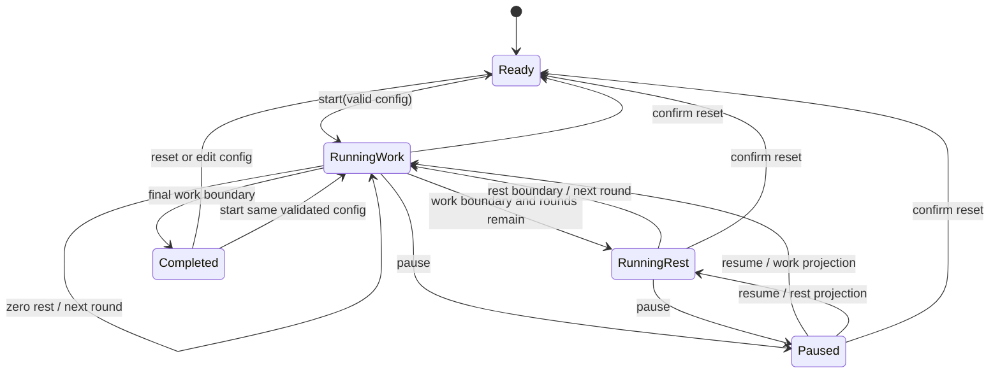

# Practice Timer MVP Specification

Confirmed requirements: configurable work/rest/rounds; start, pause, resume, reset; current round/phase and remaining time; optional supported audio; responsive EN/RU UI; local guest presets and owner cloud presets; explicit guest import policy. This is a new isolated web app, not a migration of `src/components/QualificationTimerDisplay/QualificationTimerDisplay.tsx` or battle timers.

## Proposed product details

Initial default configuration: 60s work, 30s rest, 5 rounds, audio off. Proposed configurable validation bounds: integer work 1-3600s, rest 0-3600s, rounds 1-100, total session <=24h. These are implementation defaults for product review, not requirements supplied by the brief. Reject nonfinite, fractional and out-of-bounds values; empty input is an editing draft, not valid config. No configuration changes affect a running or paused session: editing is enabled after reset/completion and start snapshots validated configuration.

Round means one work phase. Start begins round 1 work immediately; no countdown MVP. Rest occurs only between work rounds. Zero rest transitions straight to the next round's work. There is no rest after final work. Finished display is 00:00, final round N/N and completed status. Reset returns ready, round 1, full work duration and current selected configuration; it does not delete presets. Reset during active/paused session requires confirmation; redundant ready reset is harmless. Changing presets while active requires confirming reset, rather than silently replacing session state.

Core controls have clear states: Start in ready/completed, Pause while running, Resume while paused, Reset while active/paused/completed. Audio preference may change during a session without changing schedule. Preset/cloud failures do not stop a running timer.

## State model and transition diagram

```typescript
type TimerConfig = { workSeconds: number; restSeconds: number; rounds: number };
type Phase = 'work' | 'rest';
type TimerState =
  | { status: 'ready'; config: TimerConfig }
  | { status: 'running'; config: TimerConfig; elapsedAtAnchorMs: number;
      anchorMonotonicMs: number; anchorWallMs: number }
  | { status: 'paused'; config: TimerConfig; elapsedMs: number }
  | { status: 'completed'; config: TimerConfig; elapsedMs: number };
type TimerProjection = {
  status: TimerState['status']; phase: Phase | 'completed';
  round: number; rounds: number; remainingMs: number; totalRemainingMs: number;
};
```



Work/rest are derived projections of running elapsed time, not independently ticking counters. Pure functions validateConfig, transition(state,event,timeSample), project(state,timeSample), and deriveBoundaries(previousElapsed,nextElapsed) live in core. Events: START, PAUSE, RESUME, RESET, SAMPLE, CONFIGURE. TimeSample values are injected; core does not read Date/performance/window, schedule callbacks or play audio. Return typed rejected-transition results for invalid events rather than mutating global state. PAUSE samples current elapsed before freezing; if already complete, it yields completed, not paused at zero.

## Deadline/time-source behavior

Total schedule = N * workMs + (N-1) * restMs. Precompute at most 199 nonzero phase segments. Derive current phase by locating the half-open interval [start,end) containing elapsed; equality at boundary belongs to next phase, and elapsed >= total means completed. A delayed sample skips all elapsed boundaries directly, without requiring one callback per phase. Remaining display rounds up seconds using ceil(max(0,remainingMs)/1000); never shows negative values or false 00:00 before completion.

During normal same-document execution, elapsed is the stored elapsedAtAnchor plus performance.now() delta. Its monotonic behavior avoids ordinary wall-clock edits. A UI scheduler (approximately 250ms proposed, plus visibility/focus events) merely requests samples; it never subtracts a fixed interval. Accuracy is determined by time sampling, not callback counts. [MDN describes performance.now and cross-platform sleep behavior](https://developer.mozilla.org/en-US/docs/Web/API/Performance/now); no universal background precision is promised.

Proposed MVP suspension policy: real elapsed wall time counts while the page is hidden or the device sleeps. Adapter samples paired monotonic and wall time before suspension and after visibility/focus/pageshow. For normal intervals use monotonic delta. When resuming from a lifecycle gap and wall delta exceeds monotonic delta by more than a proposed 2s tolerance, use the larger nonnegative wall delta and reanchor; clamp elapsed to total. Negative wall changes do not rewind elapsed. Expose a recovery notice for divergent clocks, with Reset available. Tests inject divergence and lifecycle flags. This handles typical performance clock sleep differences but cannot distinguish a manual forward wall-clock change from true device sleep. The result may complete early after clock tampering; disclose this limitation in support/specification, not as a precision guarantee.

Do not use maximum wall delta at every foreground render, which would make every clock correction affect the timer. Time adapter owns suspension detection and tolerance, core receives resolved nondecreasing elapsed input. A long gap missing lifecycle events may still be platform-dependent; focus/pageshow and sample-gap detection trigger reconciliation, but no browser API guarantees reliable execution while suspended.

Pause always freezes elapsed, including across hidden/sleep gaps; resume takes fresh anchors and does not count paused time. Timer continuation through reload is deliberately unsupported in MVP: running state/anchors are not persisted; reload or navigation away returns ready with last valid configuration/presets. Propose active-session navigation confirmation where browsers permit, but do not rely on unload handlers. BFCache/pageshow must reconcile only when the original document/session remains, without double-counting. Separate tabs run independent sessions; presets may synchronize through storage events, never session clocks. Background audio, wake locks, alarm delivery while closed, server scheduling and session history are non-goals.

## Audio and notifications

Audio is opt-in and unlocked by an explicit user gesture. Propose distinct work/rest and completion signals. Unsupported/blocked AudioContext or disabled permission yields visible status and silent operation. No late burst of sounds after suspension: compare boundary indexes, emit only the newest relevant transition or completion once after recovery. Track emitted boundary identity in the adapter; repeated samples never replay the same signal. No sound on reset or paused samples. Do not persist AudioContext or timer scheduler handles. Stop/dispose audio resources on unmount. Sound assets/license or synthesized signal choice requires implementation review.

## Preset schema and persistence port

```typescript
type PracticeTimerPreset = {
  name: string; // trimmed, 1-80 characters, user-entered, not a translation key
  workSeconds: number;
  restSeconds: number;
  rounds: number;
  audioEnabled: boolean;
};
type StoredPreset = {
  recordId: string; // UUID
  schemaVersion: 1;
  payload: PracticeTimerPreset;
  revision: number;
  createdAt: string;
  updatedAt: string;
};
type PresetPersistence = {
  list(cursor?: string): Promise<{ items: StoredPreset[]; nextCursor: string | null }>;
  get(recordId: string): Promise<StoredPreset | null>;
  create(preset: StoredPreset): Promise<StoredPreset>;
  update(recordId: string, payload: PracticeTimerPreset, expectedRevision: number): Promise<StoredPreset>;
  remove(recordId: string, expectedRevision: number): Promise<void>;
};
```

Port is an architectural shape, not production code or a dependency addition. Cloud timestamps/revision are server authoritative; adapter ignores client-supplied timestamps on create. Guest adapter manages local revisions and UUIDs. Envelope appId is practice-timer at API level and schemaVersion is not duplicated inside payload. Strict schema rejects extra fields; version and size limits align with [06](06-database-and-privacy.md). Last valid configuration may be stored locally separately from guest preset list; it contains no active session clock or auth tokens.

Local storage JSON envelope includes storageVersion=1 and records; validate every envelope/record, quarantine malformed or unsupported data for user-visible recovery/export rather than replacing it silently. Catch unavailable/quota errors and retain in-memory working config. Cloud revisions use conditional APIs; conflicts offer reload or Save Copy. Pending cloud draft is account-scoped; clear it from memory on logout, never replay it under a different user. No promise of atomic cross-tab local writes: storage events refresh lists; warn on detected revision conflict. A later IndexedDB adapter is appropriate if multi-tab atomicity becomes required.

## Guest import/merge policy

After verified sign-in, show an optional import dialog only if guest presets exist. Choices: select presets to import, Skip for now, or leave guest presets local. Fetch cloud state first; no import on unavailable network. Names are not identity: same-name cloud records are never overwritten. Validate and compare normalized payloads; exact duplicate payloads can be marked already present after confirmation. Import distinct selected presets as new UUID cloud records. Preserve name, or let user rename duplicate names; reject quota overflow before/at server write.

Maintain an account-scoped local mapping of guest record ID + source revision -> cloud UUID for retries, without secrets. Allocate IDs before sending and retain mapping for ambiguous network results; GET to confirm before repeating create. Updates to a previously imported guest record require a new preview, not automatic cloud overwrite. Import can partially succeed per-record; report counts/failures and retry only unresolved records. Keep guest originals by default; deletion is an explicit separate action. Logout/account switching clears cloud cache and import UI; it does not expose previous-account presets as guest data. This is deliberate import, not background synchronization.

## Proposed module layout and React boundary

```text
modules/playground/apps/practice-timer/
  public.ts                 # manifest and lazy route entry
  core/                     # state, schedule, transitions, validation
  application/              # preset/import workflows
  adapters/                 # clock, audio, local/cloud preset ports
  ui/                       # TimerView, controls, config, presets, import dialog
  messages/                 # en and ru namespace
```

React hook owns engine instance/subscription and scheduler cleanup; it invokes pure transitions, renders projections, and dispatches typed effects to adapters. Development StrictMode mounting must not create duplicate running schedules/audio. Clock and audio are browser adapters, preset use cases independent of React. Design primitives come from packages/ui; shell auth changes replace the persistence adapter safely without restarting the timer. No imports from battle, participant, mobile session or another micro-app.

## Responsive and accessible interaction

Main unframed workspace centers phase/round/time with stable dimensions; compact view stacks configuration and presets beneath; wide view uses a constrained two-column layout. Keep current time and primary controls visible with long Russian labels, 320px width and 200% zoom. Numeric fields use explicit labels/units and keyboard input with validation, not dragging only. Visible commands localized via practiceTimer namespace. Screen-reader live region announces start, pause, phase, round and completion, not every second. Display remaining time as readable text with an accessible descriptive label. Keyboard Tab/Enter/Space, visible focus, dialog focus management, reduced motion, high contrast, non-color phase labels and non-audio completion are required. No global Space shortcut that interferes with form fields.

## Unit test cases for future TDD

1. Validate zero/nonfinite/fractional/oversize work/rest/rounds, total cap, Unicode preset name length and unknown keys.
2. Start projection, exact work/rest/final boundaries, one round, zero rest, final rest omitted and ceil display.
3. Delayed sample skips multiple rounds and completes without repeated side effects; total elapsed never negative/exceeds total.
4. Pause near/on boundary, paused elapsed across sleep, resume anchor, reset and invalid repeated transitions.
5. Monotonic normal progress, backward/forward wall edits in foreground, suspension wall fallback, divergent clocks, duplicate pageshow events.
6. Engine core deterministic for identical state/event/time input and no React/browser imports.
7. Preset validation/migration fixtures, duplicate import comparison, UUID mapping/retry, revisions and quota conflicts.

## Integration and E2E tests

React fake scheduler + injected time verifies rendered phase/round and controls; unmount/StrictMode cleanup; unsupported audio and storage failure. Local adapter reload/malformed/unsupported schema and multi-tab conflict. Cloud adapter unauthenticated/non-owner/oversize/stale revision and lost response; import partial success/account switch. Playwright covers EN/RU desktop/compact guest workflows, real sign-in via controlled staging fixtures, optional cloud saving, privacy-related account data isolation, keyboard/dialog/screen-reader semantics and suspended-tab catch-up where automation supports it. Device sleep/audio blocking still needs manual browser/device matrix testing; fake timers alone cannot certify browser behavior.

## BDD acceptance scenarios

```gherkin
Scenario: Guest can practice immediately
  Given I am signed out on the English Practice Timer route
  When I configure valid work, rest and rounds and press Start
  Then round 1 work begins without a registration prompt

Scenario: Pause survives time passing
  Given a running session with 20 seconds remaining in work
  When I pause, leave the tab for 2 minutes and resume
  Then the work phase resumes with 20 seconds remaining

Scenario: Delayed callbacks catch up
  Given 10 second work, 5 second rest and 3 rounds
  When the next sample arrives 32 seconds after Start
  Then round 3 work shows 8 seconds remaining
  And no burst of missed audio signals plays

Scenario: Zero rest and final completion
  Given 10 second work, zero rest and 2 rounds
  When elapsed time reaches 20 seconds
  Then the session is completed at 00:00 without a rest phase

Scenario: Guest presets persist but active sessions do not
  Given a locally saved guest preset and a running session
  When I reload the page
  Then the preset remains available and the timer is ready

Scenario: Import does not overwrite cloud data
  Given a guest preset and a different same-name cloud preset
  When I sign in and confirm importing the guest preset
  Then a separate cloud record is created and both presets remain

Scenario: Cross-device save conflict
  Given another device updated the preset after I loaded it
  When I save using my old revision
  Then the server rejects the stale update
  And I can reload or save a new copy

Scenario: Silent accessible completion
  Given audio is unavailable and the Russian route is active
  When the last work phase ends
  Then localized visible and screen-reader completion is available
```
