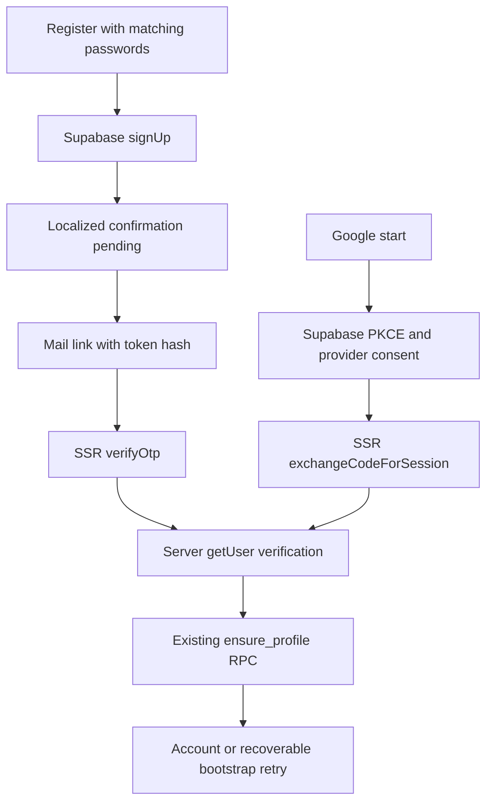

# Authentication flows

Identity owns framework-independent contracts and provider use cases; Next adapters own HTTP, cookies and origin enforcement. Supabase remains the only source of auth session state.

Email templates use RedirectTo and TokenHash with signup/recovery types. RedirectTo is generated from AUTH_SITE_URL and validated locale. Valid confirmation sets provider cookies before a clean localized redirect. Invalid, expired, malformed and already-used links always attempt verification and show the same safe error, including when a different session already exists.

Login validates normalized email/password and calls signInWithPassword. Verified identity triggers bootstrap; failure preserves auth and redirects to an explicit account retry state. Account and sensitive mutations call getUser server-side. Anonymous account access redirects to localized login with an exact allowlisted return path. Login/register redirect existing verified users unless displaying a failed callback error.

Forgot-password uses generic pending feedback for existing/unknown accounts. A recovery token establishes a verified session and opens reset-password. Reset checks current verified identity before updateUser; this also permits password changes by an already authenticated user, following Supabase's supported model. Success is localized; the old password stops working. Logout uses POST and signOut local scope, then a full navigation updates the server-rendered header.
